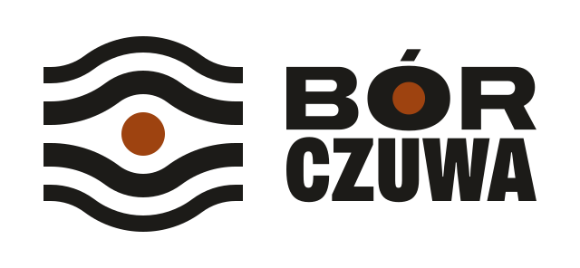

# Bór czuwa brand files

The symbol, the logotype and every icon made from them. The app and the landing page both take
the mark from this directory. Everything except `src/` and this file is generated, so change the
generator and rebuild; do not edit the SVGs by hand.



## Which file to use

| You need | Use | Notes |
| --- | --- | --- |
| The mark with the name, in a row | `lockup/horizontal.svg` | The default |
| The mark with the name, in a column | `lockup/stacked.svg` | Square spaces |
| The mark alone, 32 px and larger | `symbol/symbol.svg` | Four grain lines |
| The mark alone, 16 to 31 px | `symbol/symbol-small.svg` | Two lines and a larger knot. The full symbol blurs at these sizes |
| The name alone | `logotype/logotype.svg` | Only where the symbol is already nearby |
| Browser and home-screen icons | `icons/` | `favicon.svg`, `favicon.ico`, 180, 192 and 512 px PNGs, a maskable 512 |
| Android launcher and splash | `android/` | Foreground, background and monochrome layers on a 108 dp canvas; splash for day and night |
| Play listing and link previews | `store/` | 512 px icon, 1024 x 500 feature graphic, 1200 x 630 share image |

Each SVG comes in five colour versions, chosen by the ground it sits on.

| Suffix | Ground | Ink | Eye |
| --- | --- | --- | --- |
| none | paper `#f6f7f5` | `#1c1b18` | `#9e4310` |
| `-reversed` | dark `#1b1a17` | `#efece4` | `#e88a4e` |
| `-noc` | noc `#121110` | `#c6c2b8` | `#bda276` |
| `-black` | any light ground, one colour | `#000000` | a hole |
| `-white` | any dark ground, one colour | `#ffffff` | a hole |

These are the app's tokens from `src/routes/page.css`: `--ink` and `--action` per theme. The
light-on-dark versions are drawn 1 unit thinner per line, because light shapes on a dark ground
look heavier. They are separate drawings, so use the `-reversed` file on a dark ground and do not
recolour the default one.

Contrast against the ground is 6.0:1 or better for the eye and 10.6:1 or better for the ink in
all three themes. Inside the Ó the eye sits on ink, where it measures 2.7:1 in light and 2.2:1 in
dark. In noc it would be 1.4:1, so the noc logotype shows the eye as a hole.

## Clear space and minimum sizes

The unit is the knot's diameter, which is 48 units on the symbol's 256 canvas, a little under a
quarter of the symbol's height.

Keep one knot of empty space on every side of a lockup. The lockup files already include it, so
placing a file edge to edge with something else gives the right gap. `symbol.svg` sits on a square
canvas with its own margin.

The gap between symbol and logotype is one knot. In the horizontal lockup the logotype runs from
the top of the upper line ends to the bottom of the lower ones. In the stacked lockup it is as
wide as the symbol. These positions are fixed; do not rearrange them.

| File | Smallest height |
| --- | --- |
| `lockup/horizontal.svg` | 48 px (the symbol is then 32 px) |
| `lockup/stacked.svg` | 96 px |
| `symbol/symbol.svg` | 32 px |
| `symbol/symbol-small.svg` | 16 px |

Below 48 px, drop the name and use the small symbol.

## Do not

- Recolour the lines or the eye, or use a colour version on the wrong ground.
- Put the mark in a frame, a circle or a shield. It has no container.
- Draw the knot as anything but a plain circle, or add a highlight to it.
- Flip, rotate or stretch the mark.
- Retype the name in a font. The logotype is a drawing: the Ó, its accent and the spacing are not
  what the typeface gives you.
- Use the full symbol under 32 px.
- Set the mark on a photograph or a pattern without a plain paper or dark panel behind it.

## How it is built

`src/build.py` draws everything.

The symbol is made of straight runs and circular arcs. Each grain line is an offset of one
reference curve, so the arcs over the knot share the knot's centre and the fillets share two more
centres. The three sit on a 102-136-170 triangle. Inner lines are 26 units wide, outer lines 18,
gaps 20, and the knot has a radius of 24.

The logotype is BÓR over CZUWA in Archivo, wide over condensed. The script solves the width of
the second line so both lines measure the same. The first line is set at weight 820 and the
second at 900, which leaves the wide stems 1.15 times the condensed ones. The Ó is the O's outer
contour filled solid, a round eye, and an accent drawn in the script.

To rebuild:

```
pip install fonttools
python3 brand/src/build.py
```

The PNG and ICO exports also need ImageMagick's `magick`.

## Licence of the typeface

Archivo is by Omnibus-Type and is under the SIL Open Font License 1.1. The font file and the
licence text are in `src/fonts/`. The logotype contains outlines only, so nothing that uses the
mark needs the font.
